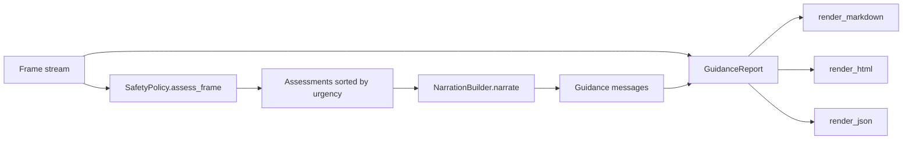

# Architecture

## Pipeline

## Components

### `models.py`

- `SceneObject` — validated detection: label, confidence, distance, bearing, closing speed, in_path.
- `Frame` — timestamped snapshot with objects and description.
- `Guidance` — one prioritised message with reasons.
- `HazardLevel` — ordered enum (info < caution < warning < critical).

### `policy.py`

`SafetyPolicy.assess()` combines:

- class weight (pedestrian > cyclist > truck > car > …)
- confidence (low confidence dampens the score)
- proximity (≤1.5 m, ≤3 m, ≤6 m, far)
- travel-path membership (×1.6)
- closing speed (up to ×2.0)
- time-to-contact (≤1.5 s forces critical)

Every assessment returns its reasons, so decisions are auditable.

### `narration.py`

- `PROFILE_LIMITS`: concise 1, standard 2, verbose 3.
- Drops informational objects when a warning-or-worse hazard exists.
- Cooldown per object label; repeats are suppressed unless urgency increases.
- `message_for()` produces short, speakable text.

### `report.py`

- `GuidanceReport.summary()` — frames, objects, unique labels, guidance counts by level, duration, average confidence, critical flag.
- `render_markdown`, `render_html`, `render_json` — deterministic, escaped, stable ordering.

### `pipeline.py`

Sorts frames by timestamp, resets the builder, runs policy + narration, returns a report.

## Invariants

| Invariant | Enforcement |
|---|---|
| No invalid scene reaches the pipeline | `SceneObject`/`Frame` validation |
| Cooldowns are per object | `_last` keyed by label |
| Urgent messages are not diluted | info dropped when warning+ exists |
| Reports are deterministic | sorted frames, sorted labels, stable JSON |
| HTML/Markdown are safe | `html.escape`, `_md_escape` |

See [TESTING.md](./TESTING.md).
