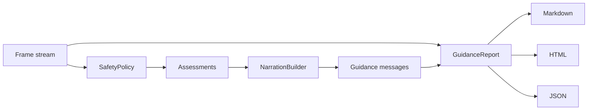

# Mobility-Guided Intelligent Information Assistant (MGIIA)

**An offline, dependency-free scene-guidance core: explainable risk scoring, cooldown-aware narration selection, and Markdown/HTML/JSON reporting — with 109 passing tests and 100% branch coverage.**

[](https://github.com/MrKyaw/Mobility-Guided-Intelligent-Information-Assistant/actions/workflows/ci.yml)
[](https://www.python.org/)
[](./TESTING.md)
[](./TESTING.md)
[](./license.txt)

---\n
## Why this repository exists

The original prototype explored YOLO, DeepLabV3, and Llama 3.2 Vision over driving video to produce annotated GIFs and PDF reports. Those artifacts are preserved. What this repository now adds is the part most multimodal demos skip: a **testable decision layer** that turns detections into safety guidance and auditable reports, without models, GPUs, or API keys.

| Concern | Implementation |
|---|---|
| **Explainable risk** | Class weights, proximity, travel-path membership, closing speed, time-to-contact. |
| **No speech spam** | Cooldowns, priority ordering, and suppression of lower-urgency messages. |
| **Accessibility** | Concise / standard / verbose profiles. |
| **Auditability** | Versioned JSON report schema, stable ordering, escaped Markdown/HTML. |
| **Testability** | 100% line and branch coverage of the core. |

---\n
## Architecture



---\n
## What's inside

```
Mobility-Guided-Intelligent-Information-Assistant/
├── mobility_guidance/             # ⭐ tested, dependency-free core
│   ├── models.py                 # Frame, SceneObject, Guidance, validation
│   ├── policy.py                 # hazard scoring and assessment
│   ├── narration.py              # prioritisation, cooldowns, profiles
│   ├── report.py                 # Markdown / HTML / JSON rendering
│   ├── pipeline.py               # orchestration
│   └── __main__.py               # CLI
├── tests/test_mobility_guidance.py  # 109 tests, 100% coverage
├── src/utility.py                # original helper (preserved)
├── data/, Images/, models/       # original media and assets (preserved)
├── ARCHITECTURE.md
├── TESTING.md
└── .github/workflows/ci.yml
```

---\n
## 60-second quickstart

```bash
git clone https://github.com/MrKyaw/Mobility-Guided-Intelligent-Information-Assistant.git
cd Mobility-Guided-Intelligent-Information-Assistant
python -m pip install -e ".[dev]"

python -m mobility_guidance --demo
pytest --cov=mobility_guidance --cov-branch --cov-report=term-missing
```

**Result:**

```text
109 passed in 0.33s
TOTAL  379 statements  142 branches  100% coverage
```

No models, video, or API keys required.

---\n
## Usage

### CLI

```bash
python -m mobility_guidance --demo
python -m mobility_guidance --demo --format json
python -m mobility_guidance --demo --format html --output report.html
python -m mobility_guidance --demo --profile concise
python -m mobility_guidance --demo --fail-on-critical
```

### Input format

```json
{
  "frames": [
    {
      "timestamp_s": 0.0,
      "description": "Approaching a crossing.",
      "objects": [
        {
          "label": "pedestrian",
          "confidence": 0.95,
          "distance_m": 1.2,
          "bearing_deg": 2.0,
          "closing_speed_mps": 0.8,
          "in_path": true
        }
      ]
    }
  ]
}
```

```bash
python -m mobility_guidance --input frames.json --format markdown --output report.md
```

### Embed the pipeline

```python
from mobility_guidance import Frame, SceneObject, GuidancePipeline, SafetyPolicy, NarrationBuilder

frames = (
    Frame(
        timestamp_s=0.0,
        objects=(SceneObject("pedestrian", 0.95, distance_m=1.2, in_path=True),),
    ),
)
report = GuidancePipeline().run(frames)
print(report.summary())
```

---\n
## Sample output

```text
# Mobility Guidance Report
Profile: standard · Frames: 5 · Duration: 16.0 s

| Time (s) | Level | Message |
| --- | --- | --- |
| 0.0 | critical | Stop. Pedestrian 1.2 metres ahead. Stop now. |
| 4.0 | warning | Slow down. Pedestrian 5.0 metres ahead. |
| 8.0 | caution | Caution: cyclist 4.0 metres ahead. |
| 12.0 | info | Car 10.0 metres away. |
```

---\n
## Test evidence

| Module | Stmts | Branches | Cover |
|---|---:|---:|---:|
| `models.py` | 90 | 40 | 100% |
| `policy.py` | 70 | 28 | 100% |
| `narration.py` | 49 | 26 | 100% |
| `report.py` | 68 | 24 | 100% |
| `pipeline.py` | 22 | 6 | 100% |
| `__main__.py` | 69 | 18 | 100% |
| `__init__.py` | 8 | 0 | 100% |
| `demo.py` | 3 | 0 | 100% |
| **TOTAL** | **379** | **142** | **100%** |

109 tests cover construction, validation, scoring, time-to-contact, cooldown suppression, escalation, profile limits, Markdown/HTML/JSON rendering, frame sorting, CLI, and error codes.

---\n
## Engineering decisions

1. **Dependency-free core.** Standard library only; the tested surface runs anywhere.
2. **Explainable scoring.** Every assessment carries its reasons (distance, path, speed, confidence).
3. **Time-to-contact can escalate.** A close, fast object becomes critical even with a low aggregate score.
4. **Cooldowns are per object.** Repeating the same message for the same hazard is suppressed unless urgency increases.
5. **Profiles control volume.** Concise (1), standard (2), verbose (3) messages per frame.
6. **Stable reports.** Sorted JSON, escaped HTML, escaped Markdown, deterministic ordering.
7. **Fail-fast validation.** Malformed scenes raise `SceneError` with a clear message.

More: [ARCHITECTURE.md](./ARCHITECTURE.md) · [docs/DESIGN_DECISIONS.md](./docs/DESIGN_DECISIONS.md).

---\n
## Honest boundaries

- This is a **decision layer**, not a perception model. It consumes detections; it does not detect.
- The original YOLO/DeepLab/Llama-Vision path is preserved in `src/` and `data/` but is not part of the CI-verified surface.
- The demo frames are synthetic.
- No accuracy, latency, or safety-certification claims are made for the original model.

---\n
## Security

A previous revision committed `src/.env` with a Together API key. It has been removed and replaced with `src/.env.example`; `.env` is ignored. **Rotate that key.**

---\n
## Recruiter snapshot

- **Role fit:** ML platform, computer vision, accessibility, backend engineer.
- **Signals:** multimodal systems thinking, explainable AI, test discipline, reporting, documentation.
- **Stack:** Python 3.10–3.12, pytest, coverage.py, GitHub Actions, Markdown/HTML/JSON.
- **Evaluate in one command:** `pytest --cov=mobility_guidance --cov-branch`.

---\n
## Author

**Kyaw Kyaw Oo** — AI/software engineer focused on reliable multimodal and agentic systems.
[GitHub](https://github.com/MrKyaw) · [Email](mailto:kyaw.tech@gmail.com)

Licensed under the MIT License. See [license.txt](./license.txt).
